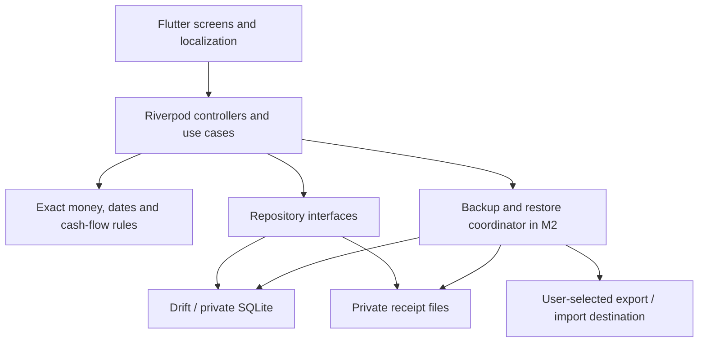

# Android architecture decisions

31 October 2026. All ADRs are **proposed for review**, not implemented. Scope: Ledger Lite; Booking remains a separate later product.

## ADR-001 — independent Flutter application in the existing workspace

Decision: add `apps/ledger_lite` using Flutter/Dart, Material 3, Riverpod, GoRouter and generated English/Simplified Chinese localization. Use immutable domain objects and feature folders with presentation, application, domain and data responsibilities as needed. Keep small features simple.

Reason: the master specification selects Android-first Flutter; existing React modules cannot be reused directly. Native Kotlin is viable but would depart from the supplied platform decision without current evidence of benefit. A web wrapper would not by itself solve durable local records and file handling.

Consequences: maintain two toolchains. Copy/adapt the existing palette and reference the original vector artwork, checking CJK fonts and licenses. Keep Dart brand components inside the app until a second Dart consumer justifies a shared package. No empty domain/design packages. No iOS/web release commitment.

## ADR-002 — local repository boundary, no backend or login

Decision: UI observes Riverpod state and issues application commands; those commands use repositories. Drift owns SQLite transactions and migrations. Receipt storage is a separate local file adapter. Widgets never write SQL or depend on web demo sessions.

Reason: the required first ledger workflow can operate without infrastructure. The existing Node memory store is unsuitable for durable records. SharedPreferences or loose JSON files would not provide the relational integrity and migration model needed here.

Consequences: device loss can mean data loss without a manual backup. There is no support-side data recovery and no multi-device concurrency. Measure whether merchants accept these limits. Do not introduce sync fields, remote identity, RLS policies or a Supabase dependency preemptively.

## ADR-003 — explicit cash-flow semantics

Decision: MYR only; integer sen; positive magnitudes; separate income, expense, refund and internal transfer kinds. Refund direction and optional original linkage remove ambiguity. Fixed Malaysian business time policy prevents reports changing when a phone timezone changes. Details and constraints are in [the data design](LEDGER_DATA_AND_PRIVACY.md).

Reason: the existing demo's `profit` field and binary-number language runtime are not the production reporting contract. Revenue recognition, tax accounting, owner funding and multiple account balances are outside this MVP. If interviews show those are essential, reassess scope before coding.

Consequences: labels must say net cash flow, and internal transfers must be visibly excluded from cash-flow totals. M1 defines and tests all four kinds; no hidden sign inference from an amount field.

## ADR-004 — migrations and staged replacement restore

Decision: maintain versioned Drift schema snapshots; test preserved records as well as table shape. Wrap migration steps appropriately in explicit transactions, with required pragmas outside those transactions. Never delete a failed database and silently recreate it. Drift documents both [migration testing](https://drift.simonbinder.eu/migrations/tests/) and [transaction handling for migration steps](https://drift.simonbinder.eu/migrations/step_by_step/).

Manual backup is a consistent logical snapshot plus receipt files and a manifest. Restore replaces the entire ledger after validation and explicit confirmation; v1 has no merge/deduplication UI. Use a journaled generation switch so database and receipt directory become active together; test process death at every switch boundary in M2. See the data design for protocol and retention.

Alternatives: direct live SQLite file copying risks inconsistent WAL state and mismatched receipts; row merging creates conflicts and duplicated totals. Neither is the v1 design.

## ADR-005 — privacy through minimal collection and explicit exports

Decision: no automatic analytics/crash SDK at launch; errors use sanitized codes. Collect beta feedback manually with permission. Store DB/files privately, request scoped file access at the point of use, and keep exports user-initiated. Do not claim database encryption; secure token storage is irrelevant without tokens and does not encrypt a ledger.

Configure legacy backup rules and modern data-extraction rules for sensitive files. Test actual behavior rather than relying solely on `allowBackup=false`: Android documents manufacturer-dependent device-transfer behavior. [Android Auto Backup](https://developer.android.com/identity/data/autobackup).

Consequences: receipt loss, shared/unlocked phones and exported files remain meaningful risks. Evaluate app lock after core recovery is reliable; a PIN screen is not file encryption. Any future telemetry, encryption or cloud service needs a revised ADR, data map and consent/disclosure review.

## ADR-006 — separate client backend when demand justifies it

Decision: no backend in Ledger v1. For a validated Booking client, design Supabase/Postgres with private storage, server-authorized tenant membership, RLS, durable audit and transactionally enforced no-double-booking; Next.js/TypeScript admin is separate from the marketing site. Do not trust tenant IDs or role selections supplied by a client.

Reason: the spec favors Postgres and client templates benefit from a relational booking model. Firebase remains an alternative requiring a written comparison against booking constraints and operating cost. This ADR is a future boundary, not a completed cloud design or verified security configuration.

Consequences: use client-owned accounts/data, isolated client production environments, explicit IP licensing and privileged-admin MFA where feasible. Never embed service-role credentials in apps. Real SMS/WhatsApp/payment integration remains mocked until separately configured and authorized.

## ADR-007 — reproducible development and evidence-based release

Decision: record a tested stable Flutter SDK revision, compatible Android/JDK/Gradle toolchain and exact direct package versions during M1; commit `pubspec.lock` for the app. Do not invent version pins before resolution. Maintain a dependency/license inventory including native transitive components and assets. Check maintenance, license and advisories before adoption.

Planned dependencies: Flutter localization SDK support, Riverpod, GoRouter, Drift, its supported SQLite integration, build_runner/drift_dev, UUID and path support. M2 adds narrowly scoped camera/file picking and archive/checksum capabilities only after review. Do not install backend, billing, OCR, recurring-entry or biometrics packages in M1. The exact package set remains uninstalled/unverified.

Add `.github/workflows/ledger-ci.yml` later: pinned SDK/tool versions; dependency restore; code generation; `dart format --output=none --set-exit-if-changed .`; `flutter analyze`; `flutter test`; debug Android build; dependency/advisory and secret checks. Test supported schema upgrades with data fixtures. Pin external CI actions and keep credentials out of logs/artifacts. Preserve the existing web workflow.

Use dev/staging/prod application IDs and separate local databases. Default to debug/internal builds; production AAB signing waits for securely supplied material and explicit release authorization. Use monotonically increasing build numbers and a documented semantic app version. Never commit keystores or signing passwords.

Target API 36+ currently matches the retrieved ordinary-new-app policy; minSdk is a separate device-research/toolchain decision. [Play target API requirements](https://support.google.com/googleplay/android-developer/answer/11926878). Recheck policy and account-specific testing eligibility in M3. CI success, local tests and a signed bundle do not imply Play approval.

## Review questions to resolve before implementation

Confirm the initial merchant workflow from interviews; assess BM language demand; confirm single-device acceptance and replace-only backup; choose the package ID and supported Android floor after checking devices. Engineering can propose defaults, but these remain explicit assumptions until evidence/review resolves them. This task stops at the planning report.
